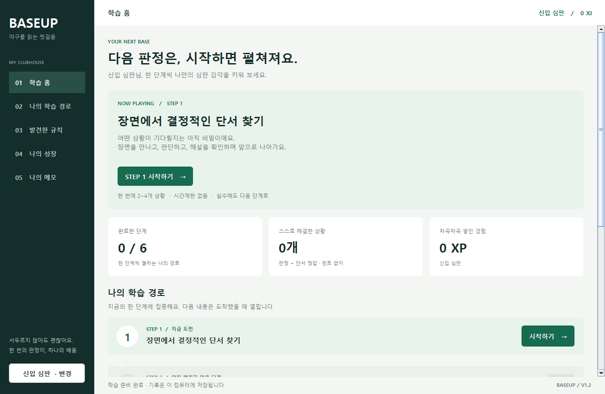
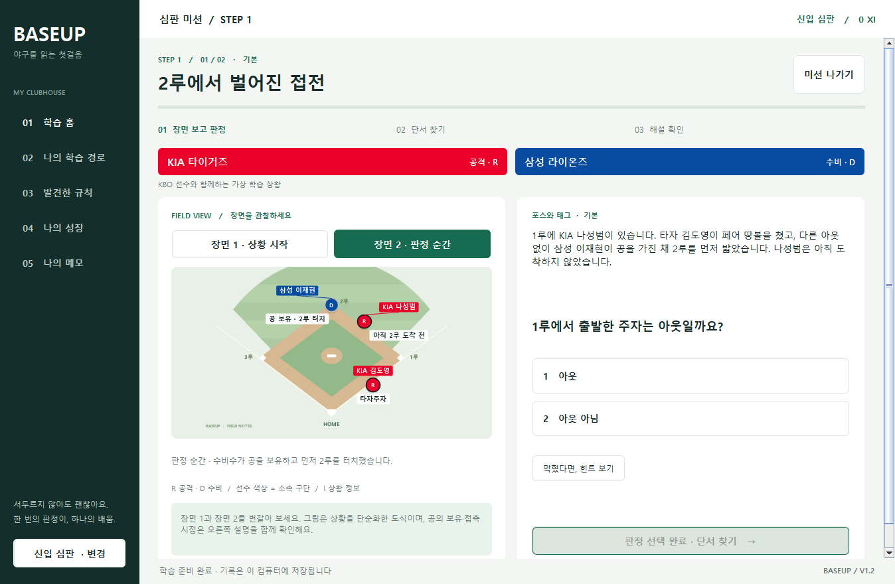

# BASEUP · Version 1 (1.2.0)

**야구를 읽는 첫걸음.** 관중이 아닌 신입 심판이 되어 상황을 판정하고, 근거를 찾아 야구 규칙을 익히는 Java Swing 데스크톱 프로그램입니다.

## 바로 실행하기

1. **JDK 17 이상**이 설치된 Windows 컴퓨터에서 이 폴더 전체를 준비합니다.
2. **`run.cmd`를 더블클릭**합니다. 처음에는 `신입 심판` 사용자로 시작합니다.
3. **STEP 1 시작하기 → 판정 선택 → 단서 선택 → 해설 → 다음 단계** 순서로 진행합니다.
4. 프로그램을 종료했다 다시 실행하면 완료한 단계와 제출 기록, 북마크, 메모가 남습니다. 여러 사용자가 있으면 왼쪽 아래에서 선택하세요.

인터넷 연결, 서버, DB, 외부 Java 라이브러리가 필요하지 않습니다. JDK는 공유 파일에 포함하지 않습니다. 실행만 하려면 배포된 JAR와 Java 17 이상 런타임으로도 가능하지만, 소스 수정과 빌드에는 JDK가 필요합니다. 기본 실행 스크립트는 `JAVA_HOME`, 일반적인 JDK 설치 폴더, `PATH` 순서로 Java를 찾습니다.

**팀에 보낼 파일:** `dist/BaseUp-v1-share.zip`. 압축을 먼저 풀고 내부의 `BaseUp-v1/run.cmd`를 실행합니다. 소스와 데이터, 설명서, 실행 JAR가 함께 들어 있으며 개인 학습 기록은 들어 있지 않습니다.





KBO 선수와 구단이 등장하는 **가상 학습 상황**입니다. KIA 빨강, 삼성 파랑 등 구단의 대표색을 선수와 단서에 연결했습니다. [선수 배정·색상·확인 출처](docs/KBO_CONTENT.md)를 참고하세요.

## Version 1에서 완성된 기능

| 기능 | 동작 |
|---|---|
| 학습 홈 | 현재 단계의 목표, 완료 단계 수, 독립 해결 수, XP |
| 순차 학습 경로 | 6단계, 기본 → 조건 변화 → 복합 조건 순으로 진행, 미래 내용 숨김 |
| 심판 미션 | 3개 주제, 6개 규칙, 기본·응용 12문항을 단계별로 배치 |
| 장면 관찰 | 24개 장면, 상황 시작/판정 순간 전환, 직접 그린 야구장 |
| KBO 선수·구단 | 10개 구단·18명 선수, 팀색 선수 마커·이름표·공격/수비 배지·단서 버튼 |
| 판정 + 단서 | 판정 뒤 그림 또는 같은 이름의 버튼으로 단서 선택, 함께 채점 |
| 피드백 | 정답과 이유, 오개념 설명, 핵심 단서 강조 |
| 힌트 | 시간제한 없이 도움받기, 힌트 사용 여부 저장 |
| 발견한 규칙 | 직접 판정을 제출한 규칙만 공개, 검색·규칙 카드·북마크 |
| 자동 재도전 | 이전에 헷갈린 규칙의 다른 문항을 새 상황 사이에 최대 2개 삽입 |
| 나의 성장 | 규칙별 진도, 제출 시각·판정·단서·힌트·시간 기록 |
| 나의 메모 | 원할 때만 쓰는 개인 메모 추가·검색·삭제, 단계 진행과 무관 |
| 로컬 프로필 | 닉네임 생성·선택, 사용자별 기록 분리 |
| 파일 보호 | UTF-8 TSV, ID/열/연결 검증, 저장 후 상태 변경, 동시 실행 잠금 |

각 단계는 새 상황 2개와 필요할 때 섞이는 이전 판단 최대 2개로 구성됩니다. 문제의 제목·장면·규칙은 시작한 뒤 공개됩니다. 틀려도 즉시 해설을 확인하고 앞으로 진행할 수 있으며, 마지막 해설에서 결과 보기까지 눌러야 다음 단계가 열립니다. 미완료 단계의 중간 위치는 저장하지 않으므로 나갔다 돌아오면 그 단계를 처음부터 풉니다. 이미 제출한 판정은 보존됩니다. 여섯 단계를 마치면 맞춤 재도전을 계속할 수 있습니다.

기존 V1 기록은 그대로 유지합니다. 이전 버전에는 단계 완료 기록이 없으므로 새 학습 경로는 STEP 1부터 시작하며, 기존 풀이 기록은 자동 재출제에 반영됩니다.

### 진도·자동 재도전·XP의 의미

- **독립 해결:** 해당 문항의 최신 제출에서 판정과 단서가 모두 정답이고 힌트를 사용하지 않음.
- **단계 완료:** 정답률과 무관하게 해당 단계의 모든 문제를 제출하고 마지막 해설을 확인하면 저장됩니다. 사용자별로 순차 해제되고, 완료한 단계는 다시 플레이할 수 있습니다.
- **자동 재도전:** 규칙별 최신 판단이 오답·틀린 단서·힌트 사용이면 다음 단계에서 같은 규칙의 다른 조건을 우선 출제합니다. 다음 단계의 필수 문제에 이미 그 규칙이 있으면 중복해서 추가하지 않습니다. 반복해서 막히면 기본 상황을 우선합니다.
- **간격:** 규칙별 연속 독립 해결이 1회이면 1일, 2회이면 3일, 3회 이상이면 7일 후 다시 섞습니다. 다른 조건의 문항을 스스로 해결하면 이전 실수가 계속 따라다니지 않습니다. 간격은 V1의 설계값이며 검증된 교육 효과를 의미하지 않습니다.
- **완주 후:** 필요한 재도전을 최대 4문항 제공하고, 모두 익숙해졌다면 오래전에 풀었던 문항부터 다시 도전합니다. 현재 문항 은행은 12개이므로 새로운 문항을 무한 생성하지 않습니다.
- **XP:** 문항마다 과거 최고 결과만 합산합니다. 판정만 정답 10, 판정+단서 정답 20, 힌트 없는 독립 해결 30입니다. 반복 제출로 무한히 증가하지 않습니다.
- **칭호:** 0~119 XP 신입 심판, 120~299 XP 루키 심판, 300 XP 이상 규칙 탐험가. 총 최대 360 XP입니다.
- 정확히 이해했는지와 오래 기억하는지는 다릅니다. 이 수치는 앱 안의 성취 지표이며, 교육 효과를 입증한 점수는 아닙니다.

## 개발하고 실행하기

소스를 고친 뒤에는 **`build.cmd`**, 그다음 **`run.cmd`**를 실행하세요. `run.cmd`는 이미 있는 JAR를 자동 재빌드하지 않습니다.

```powershell
# PowerShell, 프로젝트 최상위 폴더에서
.\build.cmd
.\test.cmd
.\run.cmd
```

### IntelliJ에서 실행

1. `파일 → 열기`에서 **BaseUp 폴더 자체**를 열고, 창을 선택하라는 메시지가 나오면 **새 창**으로 엽니다.
2. 상단 실행 구성에서 **BASEUP**을 선택하고 초록색 실행 버튼을 누릅니다. `src/main/java/baseup/App.java`의 `main()` 옆 실행 버튼으로도 시작할 수 있습니다.

소스 폴더, 테스트 폴더, UTF-8, Java 17, 작업 디렉터리가 프로젝트 설정에 들어 있습니다. `src/main/java`를 수동으로 소스 루트로 지정할 필요가 없습니다. 현재 컴퓨터에 등록된 JDK 이름 `temurin-17`을 사용합니다. 다른 컴퓨터에서 SDK가 없다고 표시되면 `파일 → 프로젝트 구조 → 프로젝트 → SDK`에서 설치된 JDK 17 이상을 선택하세요.

**`C:\JavaStudy` 전체를 열었던 기존 창과는 별도 프로젝트입니다.** 기존 창에서는 다른 주차 과제와 `build/`, `tmp/`의 복사본까지 소스로 인식해 `duplicate class` 오류가 날 수 있습니다. BaseUp 전용 프로젝트에서는 `src/main/java`와 `src/test/java`만 소스로 지정하고 임시·빌드 폴더는 제외합니다. 실행 구성의 작업 디렉터리는 `$PROJECT_DIR$`, 메인 클래스는 `baseup.App`입니다. Maven/Gradle 설정 없이 실행할 수 있습니다.

명령줄 실행:

```text
java -Dbaseup.home="C:\경로\BaseUp" -jar "C:\경로\BaseUp\dist\BaseUp-v1.jar"
```

별도 시험 기록을 쓰려면 `-Dbaseup.userdata="C:\경로\테스트기록"`을 추가합니다.

## 폴더 안내

```text
BaseUp/
  src/main/java/baseup/
    App.java          시작, 경로, 동시 실행 잠금
    model/            규칙·문제·장면·사용자·기록·퀴즈 상태
    repository/       텍스트 파일 읽기·쓰기와 콘텐츠 검증
    service/          리스트 관리, 출제, 채점·저장, 단계·자동 재도전
    ui/               Swing 화면, 테마, 야구장 그리기
  src/test/java/      JDK만으로 실행하는 통합·화면 테스트
  data/               팀이 관리하는 읽기용 콘텐츠 TSV 6개
  userdata/           첫 실행 시 생성되는 개인 기록 (공유 제외)
  docs/               구조, 과제 대응, 데이터 규격, 팀 확장 안내
  scripts/            빌드·실행·테스트·패키징
  dist/               실행 JAR 및 팀 공유 ZIP
  build/              컴파일·테스트 임시 결과 (공유 제외)
```

## 과제 안내와의 연결

`프로젝트 진행 안내.pdf`의 기술·구조 요구사항을 기준으로 작성했습니다. 문서에 적힌 제출·회의·역할 분담은 팀에서 진행할 사항이며 이 프로그램 생성으로 수행된 것은 아닙니다.

| 안내문의 요구 | V1에서 확인할 부분 |
|---|---|
| Java + Swing GUI | JFrame, JPanel, CardLayout, 이벤트 리스너, Graphics2D |
| DB 대신 텍스트 파일 입출력 | FileRepository, BufferedReader/Writer, UTF-8 TSV |
| 파일 정보를 리스트 객체로 관리 | Manager<T>, ArrayList, 불변 데이터 객체 |
| 검색·추가·삭제 | 규칙 검색, 사용자 추가, 북마크 추가/해제, 메모 추가/검색/삭제 |
| 프론트와 백엔드 분리 | ui → service → repository/model 단방향 참조 |
| 인터페이스 활용·역할 분담 | Identifiable, Repository<T>, QuestionSelector와 출제 구현 |
| 학습과 퀴즈, 게임성 | 규칙 카드, 상황 판정, 단서 찾기, 응용 문제, 성장 피드백 |
| 이미지/시각 자료 | 외부 이미지를 복사하지 않고 Graphics2D로 그린 야구장 도식 |

읽는 순서는 [ARCHITECTURE.md](docs/ARCHITECTURE.md) → [DATA_FORMAT.md](docs/DATA_FORMAT.md) → [TEAM_ROADMAP.md](docs/TEAM_ROADMAP.md)입니다.

## 검증과 알려진 범위

- JDK 17로 컴파일하고 **기존 서비스 검사 161개, 단계·자동 재출제 검사 35개, KBO 콘텐츠·렌더 검사 241개, Swing 검사 87개**를 통과했습니다.
- 실제 임시 파일을 사용해 재실행 복원, 사용자 분리, 한글/탭/줄바꿈, 삭제 후 재로드, 1·3·7일 재출제 경계, 단계 잠금·해제, 완료 저장 실패 및 재시도, 중복 제출을 검사합니다.
- Swing 버튼으로 단계 완료부터 다음 단계의 중간 재출제까지 진행해 저장을 확인하고, 주요 화면을 PNG로 렌더링합니다. 테스트는 `build/` 아래의 새 폴더만 사용합니다.
- 테스트 결과 화면은 `build/qa/screenshots/`에서 확인할 수 있습니다. 최소 창 크기는 1100×760이며 좁거나 낮은 화면은 본문을 스크롤합니다.
- V1은 기본 규칙 학습용입니다. 전체 야구 규칙, KBO 별도 운영 규정, 선수 충돌/방해/세부 어필 예외를 모두 다루지 않습니다. [확인 출처와 범위](docs/RULE_SOURCES.md)를 참고하세요.
- 장면은 정적인 2컷 도식입니다. 자유 시뮬레이션, 애니메이션, 상황을 바꾸는 퍼즐, 문제 편집 GUI, 중간 미션 이어하기, 클라우드 동기화는 후속 버전 범위입니다.
- 로컬 프로필은 학습 기록을 구분하기 위한 기능이며 비밀번호·인증 기능은 없습니다. 시작 시 첫 번째 프로필이 선택되므로 다른 사용자는 왼쪽 아래에서 바꾸세요.

## 문제 해결

- 실행할 Java가 없거나 너무 오래된 경우: JDK 17 이상 설치 후 `JAVA_HOME`을 해당 JDK 폴더로 설정하고 다시 실행합니다.
- 콘텐츠 파일을 찾지 못하는 경우: 폴더 전체를 압축 해제했는지, `data/`가 있는지, IDE의 작업 디렉터리가 BaseUp인지 확인합니다.
- “이미 열려 있습니다”: 기존 BASEUP 창을 닫습니다. 잠금 파일 자체가 남아 있는 것은 정상이며, 프로세스가 종료되면 잠금이 풀립니다.
- TSV 오류: 안내된 파일과 행을 원본과 비교하세요. 앱은 오류 파일을 자동 초기화하거나 조용히 건너뛰지 않습니다. 수정하기 전 `userdata/`를 복사해 보관하세요.
- 저장 실패: 폴더 쓰기 권한과 디스크 공간을 확인하고 다시 제출합니다. 저장 실패 시 해설 단계로 이동하지 않으며 같은 판정을 재시도할 수 있습니다.
- 기록 백업: 프로그램을 닫은 상태에서 `userdata/` 전체를 복사합니다. 팀 공유 ZIP에는 이 폴더를 넣지 마세요.
