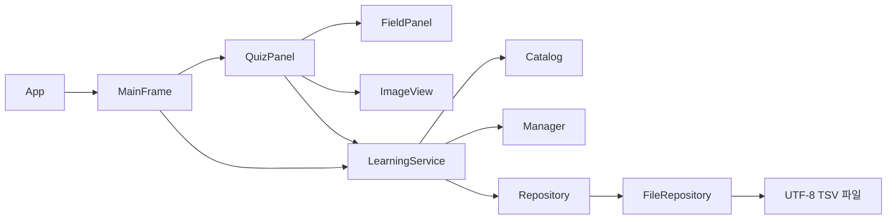

# 구조와 객체 간 협력

이 문서는 팀원들이 클래스 담당자를 정하고 기존 코드를 이해한 후 확장하기 위한 안내입니다. 단순한 입문 프로젝트를 유지하기 위해 DI 프레임워크, ORM, 웹 서버를 사용하지 않습니다. 모든 Java 코드는 표준 JDK 17 API만 사용합니다.

## 실행 흐름



1. `App`이 데이터 경로와 기록 폴더를 결정하고 파일 잠금을 획득합니다.
2. `Catalog`가 규칙·문제·장면을 파일에서 읽어 `Manager`에 보관하고 연결 ID를 검증합니다.
3. `LearningService`가 사용자와 풀이 기록, 북마크, 메모를 복원합니다.
4. Swing 이벤트 스레드에서 `MainFrame`이 만들어집니다.
5. 버튼은 서비스를 호출하고, 결과를 받아 화면만 갱신합니다.

## 클래스 책임과 공개 메서드

| 영역 | 클래스 | 역할 / 주요 메서드 |
|---|---|---|
| 데이터 | `RuleConcept` | 규칙 개념과 출처 |
| 데이터 | `Question` | 상황, 선택지, 정답, 근거, 해설 / `isAnswerCorrect`, `isClueCorrect` |
| 데이터 | `Scene`, `Scene.Token` | 장면 설명과 선수·공·조건 토큰의 좌표, 선수 연결 |
| 데이터 | `Team`, `Player`, `Matchup` | 구단 색상, 선수 소속, 문제별 공격/수비 배정 |
| 데이터 | `UserProfile`, `Attempt` | 사용자와 제출 결과 / `understood`, `independent` |
| 데이터 | `Bookmark`, `StudyNote` | 사용자별 북마크와 개인 메모 |
| 진도 | `LearningStep`, `StepCompletion` | 파일에서 읽은 단계 목표·영구 ID·문항 배치와 사용자별 완료 기록 |
| 상태 | `QuizSession` | 문제 순서, 학습 단계 번호, 입력, 힌트 / `choose`, `beginClue`, `chooseClue`, `next` |
| 리스트 | `Manager<T>` | `all`, `find`, `search`, `add`, `remove` |
| 저장 | `Repository<T>` | 매체와 무관한 `load`, `save` 계약 |
| 저장 | `FileRepository<T>` | TSV 해독 함수 주입, BufferedReader/Writer, 임시 파일 교체 |
| 콘텐츠 | `Catalog` | 파일 로딩, 스키마·ID·정답/단서 연결 검사, 규칙 검색 |
| 처리 | `LearningService` | 제출·저장·단계 완료·자동 재출제·프로필·북마크·메모 진입점 |
| 출제 | `QuestionSelector` | `select(LearningService)` 계약 |
| 출제 | `StepSelector` | 단계 잠금 검사, 새 상황 사이에 규칙별 재도전 삽입 |
| 출제 | `TopicSelector` | 기존 주제별 출제 API (기본 UI에서는 미사용) |
| 출제 | `ReviewSelector` | 기존 문항별 복습 API 유지 (기본 UI에서는 미사용) |
| 화면 | `MainFrame` | 탐색, CardLayout, 홈/학습 경로/발견한 규칙/기록/메모/결과 화면 |
| 화면 | `QuizPanel` | 기초는 선택 → 해설, 판정은 선택 → 단서 → 해설 |
| 그림 | `ImageView` | V2 PNG 비율 유지·확대 표시 |
| 그림 | `FieldPanel` | 정답을 모르는 독립적인 야구장 렌더러, 단서 클릭 알림 |
| 스타일 | `Theme` | 색·글꼴·공통 컴포넌트 |

데이터의 `record`는 Java 17의 불변 데이터 클래스입니다. private final 필드와 접근자, 생성자, equals/hashCode 등을 자동 제공합니다. 수업에서 일반 클래스를 요구한다면 동일한 메서드 계약을 유지하면서 일반 클래스로 바꿔도 됩니다.

## 한 번의 제출

```text
JUDGE
  기초형: choose(choice) → LearningService.submit(session) → FEEDBACK
  판정형: choose(choice) → beginClue()
CLUE
  chooseClue(tokenId) → LearningService.submit(session)
  1. 미션 소유 사용자·단계·단서 검증
  2. Question이 판정과 근거를 각각 검사
  3. Attempt를 만들어 파일 저장
  4. 저장 성공 시 Manager에 추가, session.recordSaved()
FEEDBACK
  LearningService.advance(session)
  → 마지막 문항이면 steps.tsv에 완료 기록 저장 후 session.next()
  → 다음 문항 JUDGE 또는 마지막 COMPLETE
```

저장 실패 시 4번을 수행하지 않아 중복/유실된 상태로 다음 문제에 넘어가지 않습니다. 중복 제출과 단계 밖 호출은 `QuizSession` 및 서비스에서 거부합니다. 서비스 테스트에는 실패 후 같은 선택을 다시 저장하는 검사가 있습니다.

## 객체지향을 설명할 때

- **캡슐화:** 화면이 파일이나 내부 ArrayList를 직접 변경하지 않습니다. Manager는 불변 복사본을 반환합니다.
- **인터페이스와 다형성:** `QuestionSelector` 하나로 StepSelector, TopicSelector, ReviewSelector의 다른 출제 방식을 실행합니다.
- **의존성 분리:** 파일 처리는 Repository 계약으로 표현합니다. 테스트나 다른 저장 방식으로 교체할 수 있습니다.
- **책임 분리:** FieldPanel은 그리기만, Question은 정답 판별, QuizSession은 단계, LearningService는 흐름, FileRepository는 파일을 맡습니다.
- **상속:** MainFrame extends JFrame, QuizPanel/FieldPanel extends JPanel, 공통 패널/버튼의 그리기 메서드 오버라이딩을 실제로 사용합니다.
- **이벤트 처리:** ActionListener, MouseAdapter, DocumentListener, WindowAdapter를 용도에 맞게 사용합니다.

## 확장할 때 지킬 계약

1. UI 패키지 밖에는 Swing import를 추가하지 않습니다.
2. 기록 변경은 서비스 메서드를 통해 처리합니다.
3. 기존 ID를 다른 규칙/문제로 재사용하지 않습니다. 판정 조건이 달라지면 새 문제 ID를 사용합니다.
4. 필드를 추가하면 TSV 헤더, 로더·저장 함수, 문서, 테스트를 함께 바꿉니다. 기존 사용자 기록의 마이그레이션도 정합니다.
5. 미션 상태를 바꾸는 기능을 추가하면 단계별 허용 동작을 먼저 합의합니다.
6. 프로그램 종료 시에는 이미 제출된 문항만 보존됩니다. 이어하기를 추가하려면 별도 세션 저장 모델이 필요합니다.

현재 MainFrame이 여러 페이지를 조립합니다. 후속 개선에서는 HomePanel, RuleLibraryPanel, ProgressPanel, NotesPanel로 추출하면 팀원이 서로 다른 파일에서 작업하기 쉽습니다. 서비스도 기능이 커지면 ProfileService/ProgressService/NoteService로 나누되 먼저 공통 메서드를 합의하세요.

## 단계와 자동 재도전

- 필수 문항은 data/steps.tsv 행 순서로 읽습니다. 그림 기초 → KBO 도식 판정 → 그림 응용 → 기록 읽기 순으로 26 STEP을 구성했습니다. 원래 V1의 6단계는 영구 ID와 문제 묶음을 유지합니다.
- `startStep`은 완료한 단계와 바로 다음 단계만 허용합니다. `StepSelector`는 새 문항 1개 → 필요한 이전 규칙 최대 2개 → 남은 새 문항 순서로 배치합니다. 필수 문항과 같은 규칙·유형은 추가하지 않습니다.
- 재도전 대상은 규칙·유형별 최신 제출로 결정합니다. 아직 잠긴 단계의 문항은 후보에서 제외합니다. 미독립 해결을 먼저, 오래된 제출을 그다음 기준으로 선택합니다. 직전과 다른 문항을 우선하되, 2회 연속 미독립 해결이면 기본 상황을 우선합니다.
- 연속 독립 해결 1/2/3회 이상에 따라 1/3/7일 간격을 사용합니다. 간격은 제품 설계값입니다.
- 완료 저장 실패 시 FEEDBACK 상태를 유지하여 결과 보기 버튼으로 다시 시도합니다. 정답률은 단계 해제 조건이 아닙니다.
- 이전 문항별 `reviewQuestions` API는 기존 호출 호환과 회귀 검사를 위해 남기며, 현재 UI의 자동 재출제는 `adaptiveQuestions`를 사용합니다.
- 기존 attempts/bookmarks/notes 파일은 바꾸지 않습니다. steps.tsv가 없는 기존 사용자의 새 학습 경로는 STEP 1에서 시작합니다.

## V1.2 구단/선수 표시

Catalog가 teams → players → matchups 및 scenes를 연결합니다. Team의 색상은 RGB 정수로 보관하여 model에 Swing/AWT 의존성을 추가하지 않습니다. FieldPanel과 QuizPanel은 같은 Team을 사용해 선수 마커, 이름표, 배지, 단서 버튼을 그립니다. 가까운 선수는 위치를 유지하고 이름표만 양옆으로 배치합니다. KboContentTest에서 소속 연결, 실제 픽셀의 팀색, 선수 클릭과 오류 데이터 거부를 검사합니다.

## 통합 버전의 호환 경계

`Question.hasImage()`가 렌더러를, `requiresClue()`가 입력 단계를 결정합니다. 저장·채점·프로필은 동일한 서비스를 사용합니다. `LearningStep.number`는 화면 순번, `key`는 userdata/steps.tsv의 기존 step 값입니다. 자세한 원본 출처와 변환은 [INTEGRATION.md](INTEGRATION.md)를 참고하세요.
