# BASEUP 발표 참고 자료

> 발표일 2026-11-30 · 발표자 참고용 정리
> 평가 항목 순서(**기획 → 기능성 → UI**)대로 정리했고, 마지막에 **객체지향 설계**, **언급할 기술**, **시연 순서**, **예상 질문**을 붙였습니다.
> 숫자는 2026-11-25 `main` 브랜치 기준입니다.

---

## 0. 한 줄 소개와 발표 흐름

**"야구 규칙, 한 베이스씩 올라가요."**
BASEUP은 야구를 처음 보는 사람이 **신입 심판**이 되어 경기 장면을 보고 판정하고, 판정의 **근거(단서)** 까지 찾으면서 규칙을 익히는 Java Swing 데스크톱 학습 프로그램입니다.

| 순서 | 내용 | 권장 시간 |
|---|---|---|
| 1 | 문제 제기와 타겟 사용자(기획) | 1분 |
| 2 | 핵심 아이디어: 퀴즈가 아니라 "심판 체험" | 0.5분 |
| 3 | 기능 시연(영상 또는 라이브) | 3~4분 |
| 4 | 교수님 피드백 반영 결과 | 1분 |
| 5 | UI 설계 포인트 | 1분 |
| 6 | 객체지향 설계와 기술 포인트 | 1.5분 |
| 7 | 마무리와 질의응답 | 남은 시간 |

---

## 1. 기획

### 문제 의식
- 야구 중계를 보면 "왜 아웃이지?", "보크가 뭐지?" 같은 순간이 많지만 **규칙 문서는 길고 어렵습니다.**
- 기존 퀴즈 앱은 정답만 맞히면 끝나서 **왜 그런 판정인지** 남지 않습니다.
- 규칙은 글보다 **장면**으로 봐야 이해됩니다. 같은 땅볼이라도 주자 위치, 아웃카운트에 따라 판정이 달라집니다.

### 타겟 사용자와 니즈
| 타겟 | 니즈 | BASEUP의 답 |
|---|---|---|
| 야구 입문자, 새로 생긴 팬 | 쉬운 것부터 차근차근 | 26단계 순차 학습, 그림 기초 → 상황 판정 → 응용 → 기록 읽기 |
| 직관·중계 시청자 | 실제 경기 장면과 연결 | KBO 10개 구단·18명 선수가 등장하는 가상 상황, 구단 색 마커 |
| 규칙을 대충 아는 팬 | "왜"를 알고 싶음 | 판정 + **근거 단서 선택**, 오개념 설명이 붙은 해설 |
| 필요할 때만 찾아보는 사용자 | 문제 없이 바로 찾아보기 | 규칙 사전(규칙 학습), 별명·영어 검색 |

### 차별점 (참신성)
1. **심판 롤플레이:** 정답 고르기가 아니라 "판정 → 근거 찾기 → 해설" 3단계입니다. 답만 맞고 근거가 틀리면 "이해 완료"로 치지 않습니다.
2. **장면이 움직입니다:** ▶ 장면 재생으로 주자·공이 영상처럼 이동한 뒤 판정 순간에 멈춥니다.
3. **놀면서 배우기:** 메인 홈의 도트 타격 게임에서 만난 상황(삼진, 볼넷, 밀어내기 등)이 규칙 카드로 이어집니다.
4. **다시 틀리지 않게:** 헷갈린 규칙은 다른 문항으로 자동 재도전하고, 1·3·7일 간격으로 복습을 권합니다.

---

## 2. 기능성

### 규모 한눈에 보기
| 항목 | 수치 |
|---|---|
| 규칙·개념 | 40개, 6개 분류 (기본 규칙·타격 규칙·주루 규칙·투수 규칙·심판 판정·기록과 용어) |
| 문항 | 52문항 = 그림 문항 40 + 장면 판정 문항 12 |
| 학습 단계 | 26 STEP |
| 문항 유형 | 객관식, **단답형 12문항**, 판정+단서 22문항 |
| KBO 콘텐츠 | 10개 구단, 18명 선수 |
| 코드 | Java 파일 93개, 약 9,400줄 (외부 라이브러리 없음, JDK 17 표준 API만 사용) |
| 자동 테스트 | 테스트 클래스 10개, **검사 2,387개** 통과 |

### 기능 목록
| 기능 | 설명 | 사용자에게 주는 가치 |
|---|---|---|
| 로그인·회원가입 | 계정별로 기록 분리, 비밀번호는 암호화 해시로 저장 | 여러 사람이 한 PC에서 써도 기록이 섞이지 않음 |
| 진행 게이지 | 전체 진행률 원형 게이지(마이페이지), 미션 진행 막대(문제 화면 위), 규칙별 해결 막대(나의 성장) | 어디까지 왔는지 한눈에 |
| 오늘의 규칙 | 날짜마다 다른 규칙 카드 + 미니 퀴즈, 넘겨 보기 | 매일 들어올 이유 |
| 규칙 학습 (26 STEP) | 앞 단계를 끝내야 다음 단계가 열림 | 난이도가 자연스럽게 올라감 |
| 심판 미션 | 판정 → 단서 → 해설, 힌트(사용 여부 기록) | "왜"까지 이해 |
| 장면 재생 | 장면 1 → 장면 2를 부드럽게 이어 재생 (STEP 7·8·11·12·16·17) | 글이 아닌 움직임으로 상황 이해 |
| 단답형 | 보기 없이 직접 입력, 띄어쓰기·영어·별명·숫자 표기 차이 인정 | 찍기 방지, 진짜 기억 확인 |
| 자동 재도전·복습 | 틀린 규칙의 다른 문항을 최대 2개 끼워 넣음, 1·3·7일 간격 복습 | 오개념 교정 |
| 규칙 학습(규칙 사전) | 문제와 상관없이 40개 규칙을 카드로 열람, 상세에서 이전/다음 규칙 넘기기, 관련 규칙 | 필요할 때 바로 찾기 |
| 퀴즈 허브 | 상황 퀴즈·일반 퀴즈 무작위 5문제, 오답 다시 풀기, 시즌 코스 지도(STEP 베이스를 눌러 시작) | 고르는 재미, 진도가 한눈에 |
| 규칙 검색 | "보크", "balk", "볼넷" 같은 별명·영어·띄어쓰기 무시, 관련도 순 정렬 | 정확한 이름을 몰라도 찾음 |
| 북마크·메모 | 규칙마다 북마크, 내 말로 메모, 즐겨찾기 메모 | 나만의 노트 |
| 마이페이지 대시보드 | 진행률, 힌트 없이 해결 수, XP, **정답률·난이도별 정답률·최근 10문제** | 내 실력 변화 확인 |
| 타격 미니게임 | 볼·스트라이크·아웃, 주자, 득점 판정 (볼넷·밀어내기·삼진·파울·몸에 맞는 공·낫아웃·폭투·홈런) | 놀면서 규칙 체험 |

### 교수님 피드백 반영 결과
| # | 피드백 | 반영 내용 |
|---|---|---|
| 1 | 게이지바 | 전체 진행률 원형 게이지, 문제 화면의 미션 진행 막대, 규칙별 해결 막대 |
| 2 | 오늘의 규칙 랜덤 | 날짜별로 섞인 순서로 매일 다른 규칙, 다음 규칙까지 카운트다운 |
| 3 | 로그인 | 회원가입·로그인·로그아웃, 계정별 기록 분리 |
| 4 | 마이페이지 대시보드 | 프로필, 즐겨찾기 메모, 진행률, 정답률, 난이도별 정답률 |
| 5 | 검색 | 메인 홈 검색창 + 백과사전 검색, 별명·영어 지원 |
| 6 | 학습/문제 분리, 책처럼 넘기는 백과사전 | "규칙 학습"=규칙 사전(읽기), "퀴즈"=문제 풀이로 메뉴 분리. 규칙 상세에서 이전/다음 규칙 버튼과 ←/→ 키 |
| 7 | 문제 화면 그림·글자 키우기 | 그림 영역 62%로 확대, 본문 17pt·질문 22pt·보기 17pt |
| 8 | 객관식 이외 | 단답형 12문항 (직접 입력, 동의어·숫자 표기 인정) |
| 9 | 영상 같은 동적 시나리오 | 장면 판정 12문항에 ▶ 장면 재생 (처음 열 때 자동 재생) |

---

## 3. UI

### 화면 구성
- **왼쪽 사이드바 고정 + 오른쪽 내용** 구조. 메뉴는 4개: 메인 홈 · 규칙 학습(규칙 사전) · 퀴즈 · 마이페이지.
- 위쪽 헤더에 현재 위치와 칭호·XP, 아래쪽 상태 줄에 "기록을 저장했습니다" 같은 알림.
- 모든 화면이 메인 홈과 같은 **남색·빨강 팔레트, 둥근 알약 버튼**으로 통일되어 있습니다.

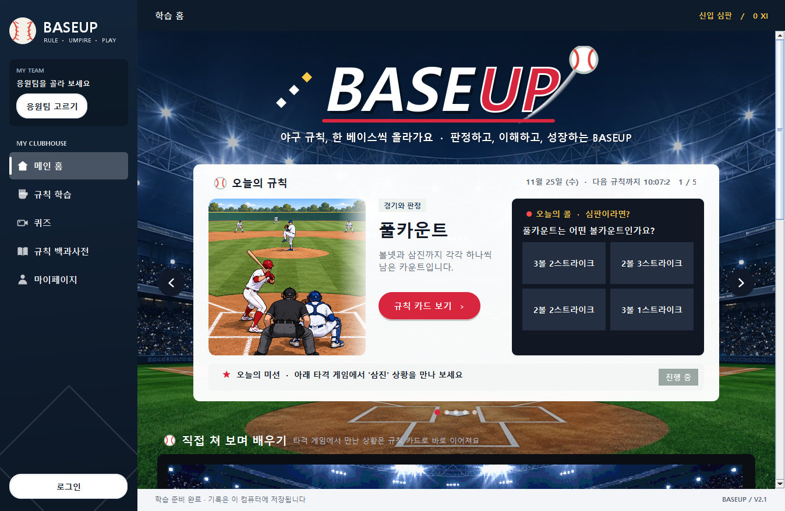

### 화면 이동 흐름
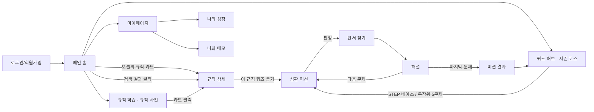

### 사용자 편의 포인트
| 포인트 | 내용 |
|---|---|
| 단계 표시 | 문제 화면 위에 `01 장면 보고 판정 → 02 단서 찾기 → 03 해설 확인` |
| 큰 그림·큰 글씨 | 그림 영역 확대, "크게 보기" 버튼으로 그림 확대 |
| 버튼 상태 | 답을 고르기 전에는 제출 버튼이 비활성화되어 실수 제출 방지 |
| 힌트 | 시간 제한 없이 언제든, 대신 "힌트 사용"으로 기록 |
| 구단 색 | 공격(R)·수비(D) 배지와 KIA 빨강·삼성 파랑 같은 팀 색으로 누가 누구인지 바로 구분 |
| 키보드 | 백과사전에서 ←/→ 로 쪽 넘기기 (검색창에 입력 중일 때는 동작 안 함) |
| 스크롤 고정 | 메인 홈에서 게임을 하는 중에 화면이 갑자기 위로 튀지 않도록 처리 |
| 창 크기 | 작은 창(1100×760)에서도 글자가 잘리지 않는지 자동 테스트로 확인 |

| 장면 판정 + 재생 | 단서 찾기 |
|---|---|
| 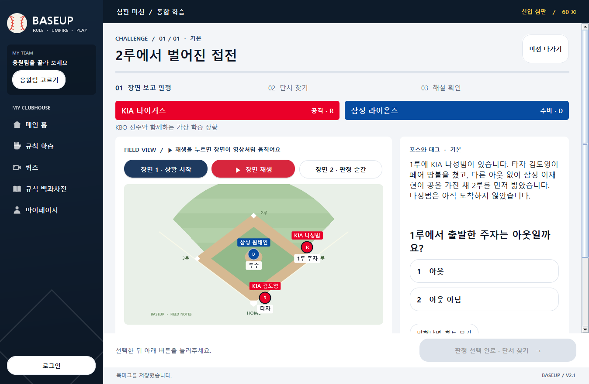 | 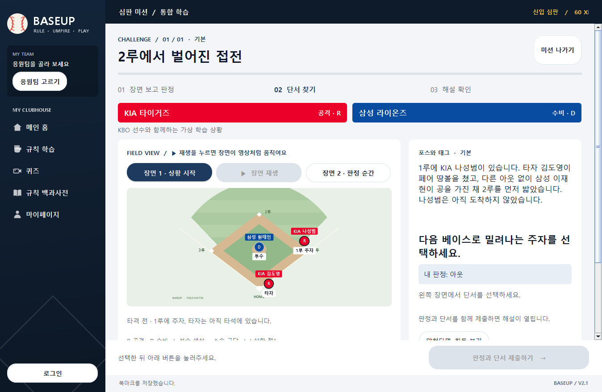 |

| 해설 | 단답형 |
|---|---|
| 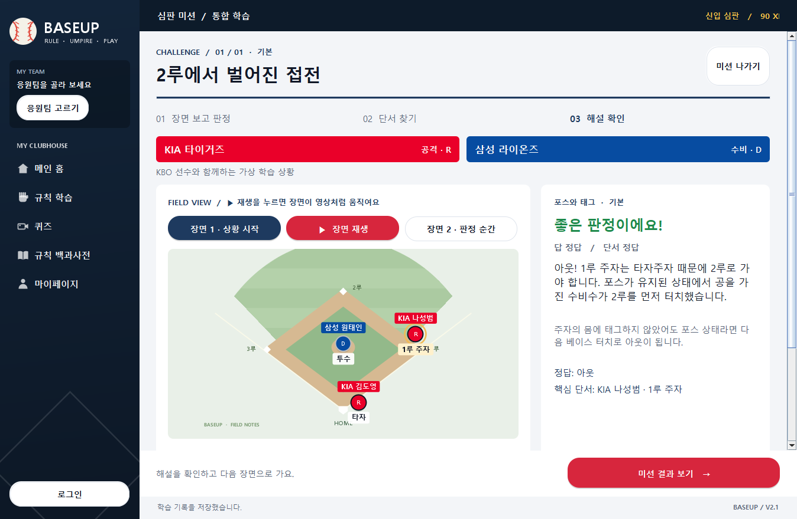 | 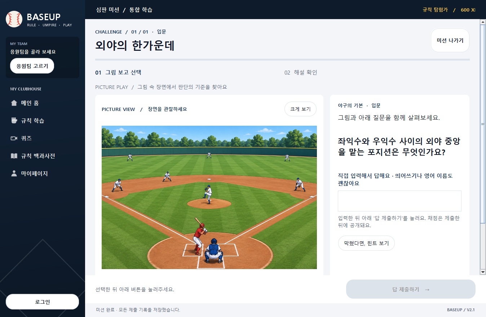 |

| 규칙 학습(규칙 사전) | 마이페이지 |
|---|---|
| 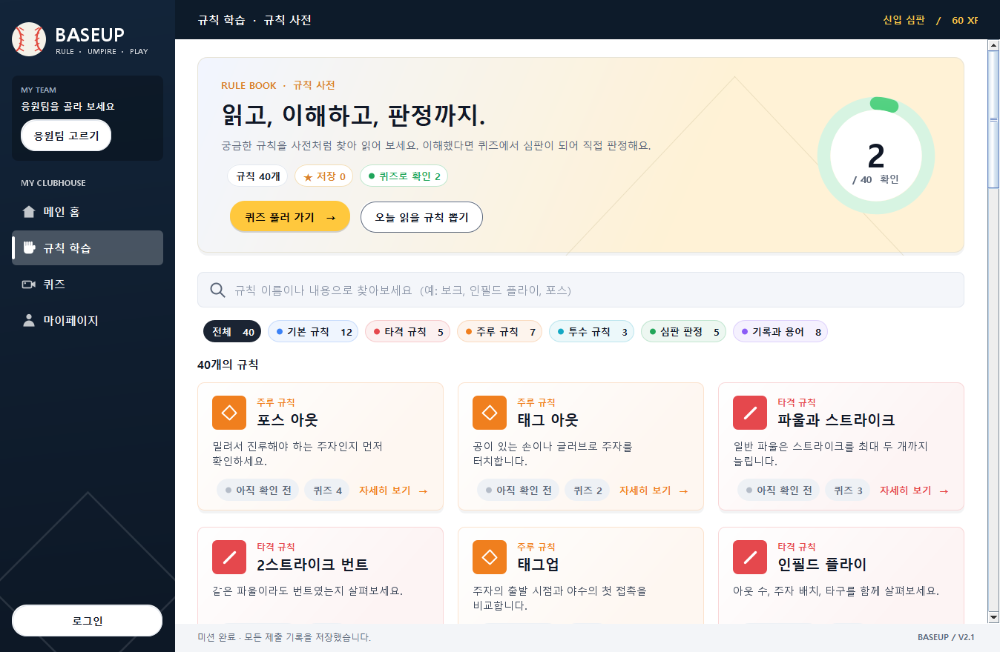 | 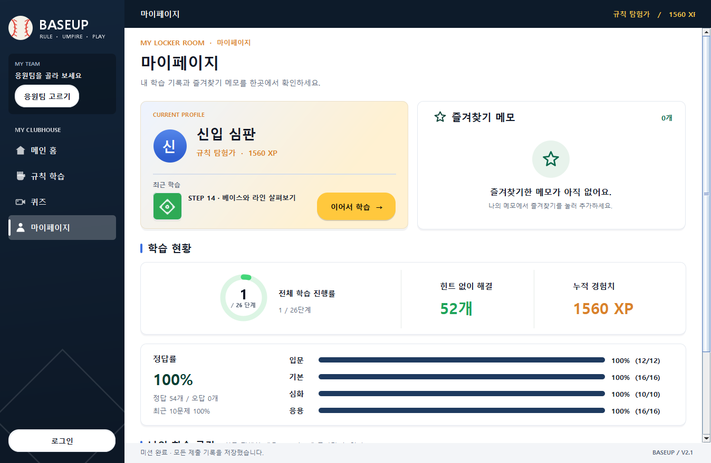 |

---

## 4. 객체지향 설계

### 4-1. 패키지 구조 (계층)
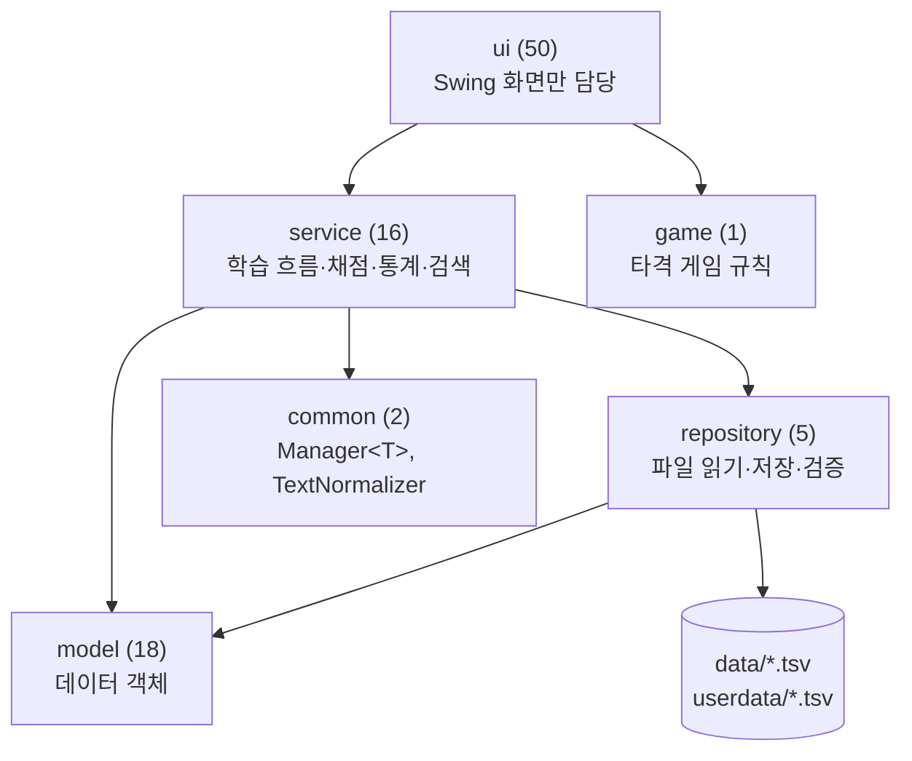
- **규칙:** `ui` 밖에서는 Swing을 import하지 않습니다. 화면은 서비스만 호출하고, 파일은 저장소만 다룹니다.
- 그래서 화면 없이도 로직을 테스트할 수 있습니다. 타격 게임도 규칙(`GameState`)과 그림(`PitchGame`)이 분리되어 있습니다.

### 4-2. 핵심 클래스 관계
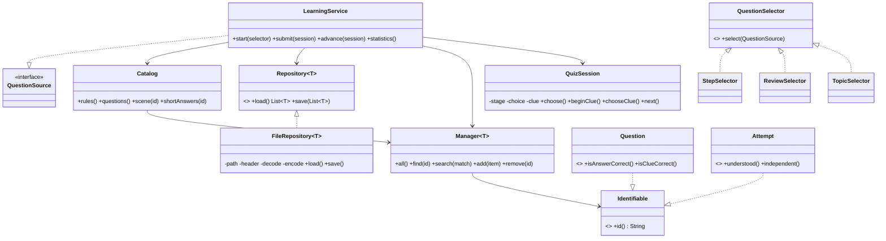

> `LearningService`는 `QuestionSource`를 구현합니다. 출제 클래스(`StepSelector` 등)는 `QuestionSource`로만 서비스를 보기 때문에, 채점이나 저장 같은 메서드는 호출할 수 없습니다. 인터페이스로 **필요한 기능만 보여 주는** 예입니다.

### 4-3. 객체지향 원칙별 실제 예

| 원칙 | 우리 코드의 예 | 말할 포인트 |
|---|---|---|
| **캡슐화** | `QuizSession`은 단계(JUDGE → CLUE → FEEDBACK)를 스스로 관리하고, 단계에 맞지 않는 호출은 예외로 막음. `Manager<T>`는 내부 리스트 대신 **불변 복사본**을 돌려줌 | 화면이 실수로 상태를 망가뜨릴 수 없음 |
| **상속** | `MainFrame extends JFrame`, 화면 7개(`HomeScreen`·`RuleBookScreen`·`RuleDetailScreen`·`QuizScreen`·`MyPageScreen`·`RecordsScreen`·`NotesScreen`)가 추상 클래스 `Screen`을 상속해 `build()`만 각자 구현 | 공통 기능(페이지 제목, 문단, 입력 감지)은 부모에 한 번만 |
| **다형성** | `QuestionVisual`(추상) ← `ImageQuestionPanel`(그림), `SceneQuestionPanel`(야구장 도식). 퀴즈 화면은 어느 쪽인지 몰라도 `selectClue()`만 호출 | 문항 종류가 늘어도 퀴즈 화면은 그대로 |
| **인터페이스(전략 패턴)** | `QuestionSelector` 하나로 `StepSelector`(단계 학습), `ReviewSelector`(복습), `TopicSelector`(주제별) 출제 방식 교체 | 출제 방식 추가 = 클래스 하나 추가 |
| **의존성 역전** | 서비스는 `Repository<T>` 인터페이스에만 의존, 실제 구현은 `FileRepository<T>`. 테스트에서는 메모리 저장소(일부러 저장 실패도 낼 수 있는 가짜)를 주입 | 파일 대신 DB로 바꿔도 서비스 코드는 그대로 |
| **제네릭** | `Manager<T extends Identifiable>`, `FileRepository<T>`가 규칙·문항·기록·메모 등 모든 데이터에 재사용 | 같은 코드를 타입마다 다시 쓰지 않음 |
| **단일 책임** | `Question`은 정답 판별, `ReviewPolicy`는 복습 시점, `LearningStatistics`는 통계, `RuleEncyclopedia`는 검색, `AnswerChecker`는 단답형 채점 | 기능을 고칠 때 볼 곳이 하나 |
| **불변 객체** | `record`(`Question`, `Attempt`, `Scene`, `RuleConcept` 등)와 `enum`(`RuleCategory`) | 여러 화면이 같은 데이터를 공유해도 안전 |
| **화면과 로직 분리** | 화면 이동은 `ScreenActions` 인터페이스로 요청 → 각 화면은 `MainFrame`을 몰라도 됨. 타격 게임은 `GameState`(규칙)와 `PitchGame`(그림) 분리 | 화면을 다시 만들어도 로직 재사용 |
| **이벤트 처리** | `ActionListener`, `MouseAdapter`, `DocumentListener`, Swing `Timer`(장면 재생 애니메이션) | 사용자 입력에 반응하는 GUI |

### 4-4. 한 번 제출할 때 객체들의 협력
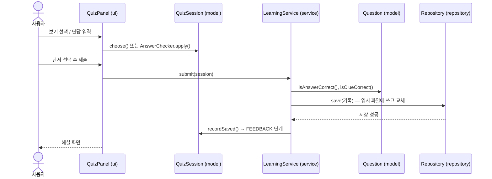
- **저장에 성공한 뒤에만** 상태를 바꿉니다. 저장이 실패하면 다음 문제로 넘어가지 않아 기록이 사라지거나 두 번 저장되지 않습니다.

---

## 5. 언급할 만한 기술·기법 (간단히)

| 기술 | 한 줄 설명 |
|---|---|
| 파일 입출력(TSV) | 규칙·문항·장면·기록을 UTF-8 TSV로 관리. 비개발자 팀원도 엑셀처럼 문항을 추가할 수 있음 |
| 데이터 검증 | 시작할 때 열 이름, ID 연결, 정답·단서 연결을 검사하고 틀리면 어느 문항이 문제인지 알려 줌 |
| 안전한 저장 | 임시 파일에 먼저 쓰고 한 번에 교체(atomic move). 저장 중 꺼져도 파일이 깨지지 않음 |
| 동시 실행 방지 | 같은 기록 폴더로 프로그램을 두 번 실행하지 못하게 파일 잠금 |
| 비밀번호 보호 | 비밀번호를 그대로 저장하지 않고 PBKDF2(소금값 + 21만 번 반복) 해시로 저장 |
| 검색 정규화·점수 | 전각/반각·대소문자·띄어쓰기를 통일한 뒤 제목 일치 100점, 별명 일치 95점… 관련도 순 정렬 |
| 단답형 채점 | 동의어 목록 + 숫자는 값으로 비교("0.3" = "0.300"). 채점 결과를 기존 보기 번호로 바꿔 저장해 통계·복습 코드를 그대로 재사용 |
| 장면 재생 애니메이션 | 두 장면의 같은 선수 좌표를 보간(ease-in-out), Swing Timer로 약 30fps 재생 |
| 간격 반복 복습 | 힌트 없이 연속으로 해결한 횟수에 따라 1일 → 3일 → 7일 뒤 복습, 틀리면 바로 복습 대상 |
| 오늘의 규칙 | 연도별로 섞은 순서에서 날짜로 골라, 같은 날엔 같은 규칙·다른 날엔 다른 규칙 |
| 자동 테스트 | JUnit 없이 직접 만든 테스트 10개, 검사 2,387개. 화면 테스트는 실제 Swing 화면을 띄워 클릭하고 스크린샷까지 저장 |

---

## 6. 시연 순서 (유튜브 영상 / 라이브 공통, 약 4분)

1. **로그인** — 회원가입 후 로그인 (계정별 기록 분리 언급).
2. **메인 홈** — 오늘의 규칙 카드 넘기기 → 미니 퀴즈 → "규칙 카드 보기"로 백과사전 이동.
3. **검색** — 홈 검색창에 `balk` 입력 → "보크" 결과 클릭.
4. **백과사전** — 분류 바꾸기, 다음 쪽 → 버튼과 키보드 →, 관련 규칙 클릭, 북마크.
5. **규칙 학습** — STEP 1 시작 → 그림 문제(객관식) → **단답형**(E05 "포수": `catcher`로 입력해도 정답).
6. **장면 판정** — STEP 7 문제(Q01 "2루에서 벌어진 접전") → **▶ 장면 재생** → 판정 → 단서 선택 → 해설.
   - STEP 7은 1~6단계를 끝내야 열립니다. **영상용 계정은 미리 STEP 6까지 풀어 두세요.**
7. **마이페이지** — 진행률, 정답률, 난이도별 정답률 막대, 즐겨찾기 메모.
8. **타격 게임** — 메인 홈 아래에서 몇 번 쳐 보고, 볼넷·삼진 상황이 규칙으로 이어지는 것 보여 주기.

> 영상 링크는 **수업 시작 전 OTP 사이트에 등록**해야 합니다.

---

## 7. 예상 질문과 답변

| 질문 | 답변 |
|---|---|
| DB 대신 파일을 쓴 이유는? | 설치 없이 `run.cmd` 하나로 실행되게 하려고. 저장소를 `Repository` 인터페이스로 분리해 두어서 DB로 바꿀 때는 구현 클래스만 추가하면 됩니다. |
| 단답형 채점은 오타도 인정하나요? | 띄어쓰기·대소문자·영어 이름·별명·숫자 표기 차이는 인정하고, 오타는 인정하지 않습니다. 오답 보기와 같은 말이 허용 답안에 들어가면 프로그램 시작 때 막습니다. |
| 문제를 추가하려면? | `data/image_questions.tsv`에 한 줄, `steps.tsv`에 배치하면 됩니다. 잘못 넣으면 시작할 때 어느 줄이 문제인지 알려 줍니다. |
| 장면 재생은 영상 파일인가요? | 아닙니다. 장면 1과 장면 2의 선수 좌표를 코드로 이어 그리는 애니메이션이라 파일이 가볍고, 장면 데이터만 추가하면 새 시나리오가 됩니다. |
| 객체지향을 어디에 썼나요? | 4장 표: 출제 방식은 전략 패턴(인터페이스 + 다형성), 저장은 인터페이스로 분리, 화면은 추상 클래스 상속, 데이터는 불변 record. |
| 테스트는 어떻게 했나요? | 직접 만든 테스트 10개로 검사 2,387개. 로직뿐 아니라 실제 화면을 띄워 버튼을 누르고 결과 화면을 캡처해 확인합니다. |
| 실제 KBO 선수를 써도 되나요? | 학습용 **가상 상황**이라고 화면에 표시하고, 선수 배정과 출처를 `docs/KBO_CONTENT.md`에 정리했습니다. |

---

## 8. 발표 전 체크리스트
- [ ] 영상용 계정을 STEP 6까지 풀어 두기 (장면 재생은 STEP 7부터)
- [ ] `main` 최신 코드로 `run.cmd` 실행 확인
- [ ] 유튜브 링크 OTP 사이트 등록 (수업 시작 전 마감)
- [ ] 발표 자료에 화면 캡처 넣기 (`docs/presentation/images/`)
